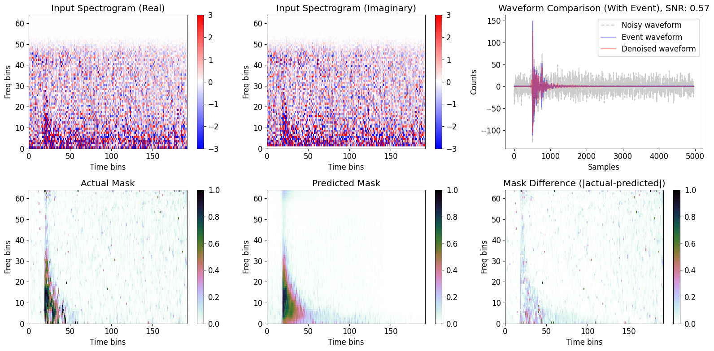
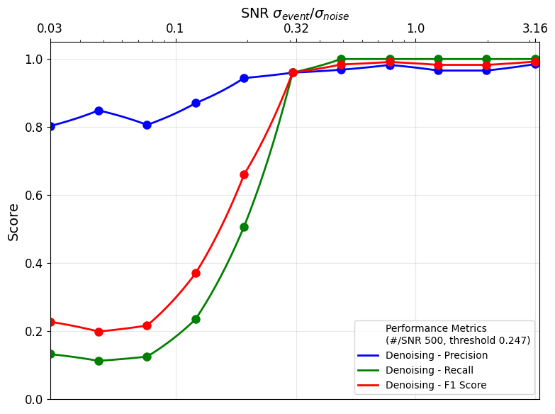
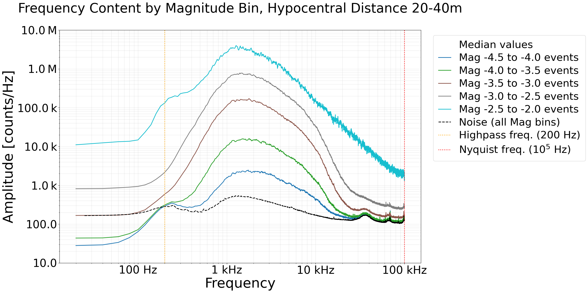

# Bedretto seismic denoising

Deep-learning denoising of acoustic-emission recordings from the Bedretto Underground Laboratory (Ticino, Swiss Alps).

## Problem

Fault-activation experiments at the Bedretto Underground Laboratory produce very large numbers of tiny seismic events (magnitudes around −4.5 to −2), recorded at 200 kHz. Many of the smallest events are buried in noise that overlaps with them in frequency, so a traditional bandpass filter alone cannot recover them.

## Approach

A U-Net predicts a time–frequency mask that separates event energy from noise, following MarsQuakeNet (Dahmen et al., 2022). It is trained on synthetic mixtures of high-SNR catalogue events and real noise recordings, with random SNR, time shift and polarity. The masked spectrogram is used to denoise a waveform, and the mask can also serve as an event detector.

<p align="center"></p>

*Noisy input spectrogram, true and predicted mask, and the recovered waveform for an event at SNR 0.57.*

<p align="center"></p>

*Detection precision, recall and F1 on held-out test data as a function of SNR.*

## Publication

This work contributed to the paper below. It includes Figure 7: median amplitude spectra for acoustic-emission recordings in five magnitude bins at 20–40 m distance, and for ambient noise.

<p align="center"></p>

> Meier, M.-A., Selvadurai, P., Gischig, V., …, Meyers, O., …, Wiemer, S., & Giardini, D. (2026). Activating a Natural Fault Zone in the Swiss Alps. *Seismica*, 5(1). https://doi.org/10.26443/seismica.v5i1.2065

```bibtex
@article{meier2026activating,
  title   = {Activating a Natural Fault Zone in the Swiss Alps},
  author  = {Meier, Men-Andrin and Selvadurai, Paul and Gischig, Valentin and others},
  journal = {Seismica},
  volume  = {5},
  number  = {1},
  year    = {2026},
  doi     = {10.26443/seismica.v5i1.2065}
}
```

## Repository structure

```
notebooks/       01 dataset statistics, 02 preprocessing, 03 model training, 04 performance vs SNR
scripts/         check of the denoising approach
figures/         figures used in this README
```

## Acknowledgements

This work was carried out at the Institute of Geophysics, Department of Earth and Planetary Sciences, ETH Zürich in 2025. I was supervised by Men-Andrin Meier and Nikolaj Dahmen and received support from Lu Tian. The model and training pipeline are adapted from MarsQuakeNet:

> Dahmen, N. L., Clinton, J. F., Meier, M.-A., Stähler, S. C., Ceylan, S., Kim, D., Stott, A. E., & Giardini, D. (2022). MarsQuakeNet: A more complete marsquake catalog obtained by deep learning techniques. *Journal of Geophysical Research: Planets*, 127(11), e2022JE007503. https://doi.org/10.1029/2022JE007503

## License

Code: [MIT](LICENSE). Figure 7 is reproduced from Meier et al. (2026) under CC BY 4.0.
